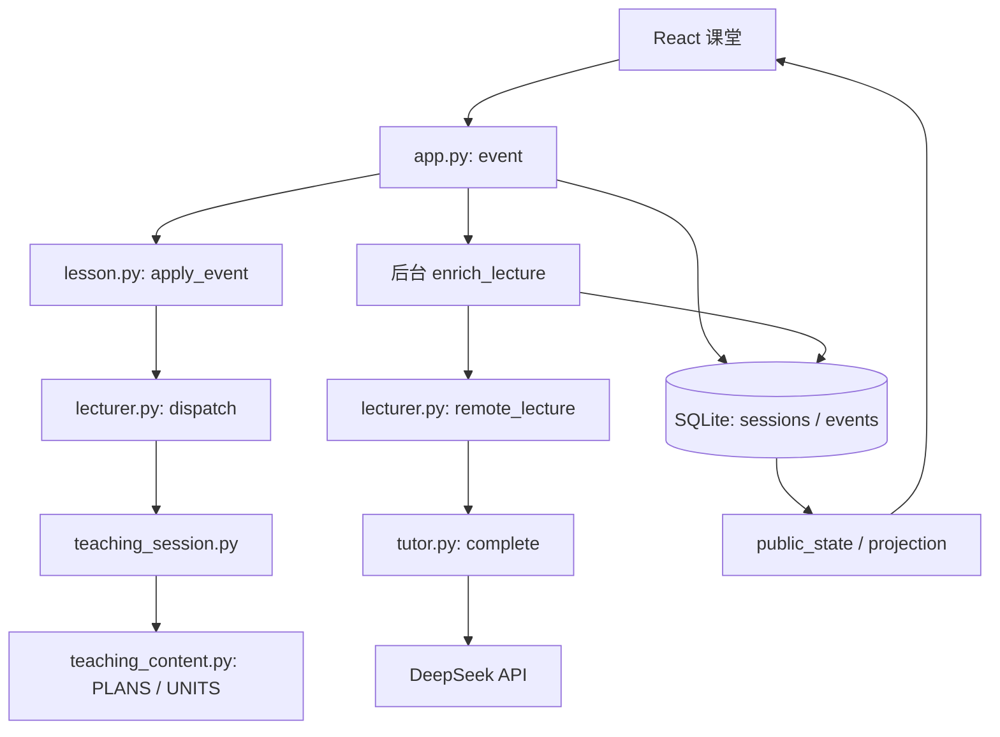
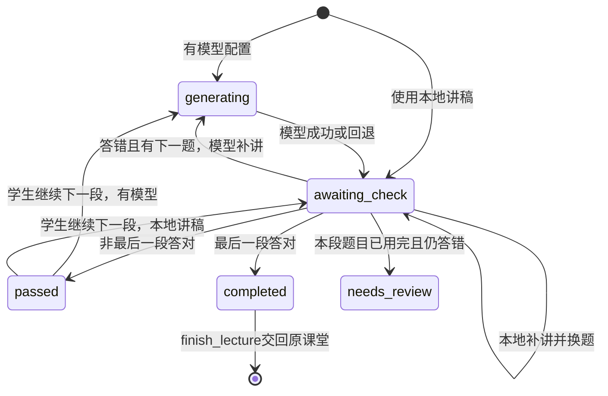

> 范围说明：旧版行列式授课协议 protocol=2，适用于 lecturer.py / teaching_session.py；不是当前默认聊天授课 Agent。 当前系统见 [系统说明](IMPLEMENTATION.md)，默认开发入口见 [通用 Agent 协议](CHAT_AGENTS_DEVELOPMENT.md)。文内测试数量为历史快照。

# 授课 Agent 开发文档

维护日期：2026-10-21  
适用代码：当前本地 MVP，授课任务协议 `protocol = 2`  
项目目录：`D:\aiteacher`

本文记录**已经实现的行为和协议**。第 12 节单独列出尚未实现的能力。后续修改授课流程、任务字段或事件时，应同步更新本文。

## 1. 定位与权限

授课 Agent 接收调度器指定的知识点、目标和重点，分段讲解，配合随堂理解检查，根据结果继续或补讲，并支持插问、暂存与恢复。

它是任务驱动的模型模块，不是独立运行的服务，也不是自主规划整门课的多 Agent 系统。当前角色共用同一个后端进程。

| 角色 | 实现 | 权限 |
| --- | --- | --- |
| 课堂调度器 `scheduler` | 状态机 | 派发任务、管理课堂阶段、安排检查后的分支 |
| 授课 Agent `lecturer` | DeepSeek 生成；失败时使用审核讲稿 | 讲授当前要点、回答学生疑问；不直接修改课堂状态或评分 |
| 测评模块 `assessment` | 程序规则与精确有理数比较 | 判定选择题和数值题、记录随堂表现 |

必须保持的边界：

- 随堂检查通过不等于独立掌握，不得据此修改课程独立达标状态。
- 回答了问题不等于学生已经理解；疑问由学生确认解决。
- 模型生成结束不等于整个授课任务结束。
- 模型不能自行切段、派生其他 Agent、执行任意代码或写数据库。
- 聊天中的交接卡片是根据真实程序事件生成的日志，不是模型之间自由协商的实录。

## 2. 模块与调用关系



| 文件 | 开发入口 |
| --- | --- |
| [lecturer.py](../backend/lecturer.py) | `TOPICS`、角色注册、`dispatch`、`current_task`、`remote_lecture` |
| [teaching_content.py](../backend/teaching_content.py) | 审核材料 `UNITS`、主题组合 `PLANS`、检查题及答案 |
| [teaching_session.py](../backend/teaching_session.py) | 段状态、判分与分支、公开投影、疑问管理、暂停恢复、旧任务升级 |
| [lesson.py](../backend/lesson.py) | 课堂事件路由、阶段切换、消息追加、报告组装 |
| [app.py](../backend/app.py) | HTTP、鉴权、事务、幂等、后台生成、重启恢复 |
| [tutor.py](../backend/tutor.py) | 配置读取、模型请求、普通答疑、错误脱敏 |
| [main.tsx](../src/main.tsx) | `LecturePanel`、`ChatMessage`、API 调用、轮询、报告导出 |
| [teaching.css](../src/teaching.css) | 分段检查、会话记录、待解决疑问、窄屏布局 |

`lesson.py` 与授课模块部分互相引用，当前通过函数内部导入避免初始化循环。重构时不要直接将全部延迟导入移至文件顶部。

## 3. 教学内容结构

### 3.1 主题与实际分段

| topic | 主题 | `PLANS` 中的单元顺序 |
| --- | --- | --- |
| `triangular_method` | 化上三角形整体方法 | `structure` → `eliminate` → `restore` |
| `addition` | 倍加与缩放 | `addition` → `row_calculation` → `scale` |
| `swap` | 换行与符号 | `pivot` → `swap` → `restore` |
| `triangle` | 上三角形求值 | `structure` → `product` → `restore` |

共 9 个可复用单元，每单元 3 道检查题。当前每项主题恰好三段，但业务推进使用 `segment_total`，不要在新逻辑中写死段数。

`TOPICS` 保存主题元数据。**实际分段顺序以 `PLANS` 为准，当前段讲稿以 `UNITS.lesson/remedy` 为准**。`TOPICS.local` 是整段讲授时期遗留的文本，目前 `dispatch` 不用它创建分段讲稿。

### 3.2 单元与检查题

每个单元包括：`title`、`objective`、`lesson`、`remedy`、`checks`。

```json
{
  "title": "示例单元",
  "objective": "能够完成指定的小目标",
  "lesson": "初次讲解的审核材料",
  "remedy": "回答错误后使用的补讲材料",
  "checks": [
    {
      "kind": "number",
      "prompt": "示例：2乘3等于多少？",
      "answer": "6",
      "explanation": "2乘3等于6。"
    }
  ]
}
```

此例只演示字段。实际题库按每段三道不同问题维护。

- `number`：客户端提交字符串；用 `math_engine.number` 解析为精确有理数后比较。
- `choice`：增加 `choices` 数组；答案为从 0 开始的整数索引。布尔值不算有效索引。
- 无效输入不消耗一次检查机会。
- 正式检查定义、标准答案和解释仅保存在服务端。公开当前题时移除 `answer` 和 `explanation`。
- 学生自己的作答记录和已公布的反馈可以展示，不能与隐藏答案字段混淆。

## 4. 任务与授课会话数据

### 4.1 外层课堂状态

授课数据嵌入现有课堂 JSON，没有独立的授课数据库表：

| 字段 | 含义 |
| --- | --- |
| `phase` | 授课中为 `lecture`；其余如 `guided_practice`、`independent_assessment` |
| `revision` | 客户端事件并发控制版本 |
| `teaching_tasks` | 当前课堂的全部授课任务历史，服务端保存 |
| `active_teaching_task` | 当前活动任务 ID；非授课状态通常为 `null` |
| `messages` | 学生消息、讲解、测评反馈、调度和交接日志 |

`public_state` 不直接暴露整个 `teaching_tasks`，而是返回当前任务投影、暂停任务摘要或报告摘要。

### 4.2 任务字段

| 字段 | 含义与约束 |
| --- | --- |
| `id` | UUID，关联消息、检查、后台任务 |
| `protocol` | 当前为整数 `2` |
| `from_agent` / `to_agent` | `scheduler` → `lecturer` |
| `topic` / `title` | 主题标识与显示标题 |
| `objective` / `outline` | 主题级目标与提纲；具体段顺序仍由 `PLANS` 控制 |
| `reason` / `focus` | 派发原因及需要关注的诊断观察 |
| `constraints` | 一次一要点、不代做、不判断掌握等边界 |
| `return_phase` | 交回或暂存时恢复的课堂阶段 |
| `status` | `pending`、`ready`、`paused`、`completed`、`cancelled` |
| `message_id` | 最新一轮讲解的消息 ID，不代表全部历史讲解 |
| `scheduled` | 后台工作已经安排，避免重复排队；公开投影移除该字段 |
| `source` | 生成落地时写入 `ai` 或 `local`，不是掌握状态 |
| `session` | 下述持久化授课会话 |

### 4.3 `session` 字段

| 字段 | 含义 |
| --- | --- |
| `segment_index` / `segment_total` | 当前段索引（从 0 开始）与总段数 |
| `segment_status` | 当前段状态，见第 5 节 |
| `passed_segments` / `completed_points` | 已通过随堂检查的段索引与标题 |
| `variant` | 当前检查题在该单元 `checks` 中的索引 |
| `attempts` | 当前段已经接受的有效作答次数；切段归零 |
| `checks` | 所有段的检查历史：题目、学生作答、结果、尝试次数、`formative=true` |
| `latest_check_result` | 最近一次检查结果；切段清空 |
| `generation_id` | 当前讲解生成令牌；重新讲解或暂停时更换 |
| `generation_mode` | `initial` 或 `remedial` |
| `check_id` | 当前可提交题目的实例 ID；换题或切段时更换 |
| `lecture_message_id` | 当前段最新讲解消息 ID |
| `used_example_ids` | 已使用材料的标识列表；不是模型自由生成例子的结构化解析结果 |
| `open_questions` / `resolved_questions` | 待确认与学生已确认解决的问题 |
| `resume_point` | 阶段、题目 ID、步骤数；用于记录恢复位置，不是整份课堂回滚快照 |
| `outcome` | 正式结束时写入 `formative_checks_passed`，不代表独立掌握 |

问题记录的 `id` 对应回答消息 ID，另存问题文本和所属段。状态为 `awaiting_answer`、`answered`、`needs_followup`；学生确认后移入已解决列表并记为 `student_confirmed`。

### 4.4 前端投影

`projection(task)` 在任务基础上增加：

- `segment`：当前段的索引、标题、目标、状态和公开检查题。
- `segments`：整项任务的段标题与通过标记。

只在 `generating`、`awaiting_check` 状态返回当前题。生成中可以显示题面，但前后端都禁止提前提交。`passed`、`completed`、`needs_review` 时 `segment.check=null`。

## 5. 状态转换与推进规则



这里的节点是 `session.segment_status`，不是外层 `task.status`：

- `task.status=ready` 仅表示本轮内容已就绪，不能据此允许整项授课结束。
- 非最后一段答对后停在 `passed`，必须显式提交 `next_teaching_segment`。
- 最后一段答对且所有段均通过，才设置 `segment_status=completed`。
- `finish_lecture` 检查全部段完成后，设置任务 `completed`、清除活动 ID、恢复 `return_phase`。
- `needs_review` 没有自动补充新题或跳过机制。可继续问答、暂存回练习；恢复此任务仍保留待复习状态。
- 任意授课状态可以 `pause_lecture`。任务改为 `paused`，保留会话并恢复原阶段。
- `finish` 是结束整堂课的事件，取消活动任务并进入报告；与 `finish_lecture` 不同。

在独立题中派发或恢复授课，会将本题标为接受帮助。之后仍需按原测验逻辑使用新题验证。

## 6. HTTP 与事件协议

### 6.1 公共入口

| 方法与路径 | 用途 |
| --- | --- |
| `POST /api/sessions` | 创建课堂，返回会话 ID、恢复 token、初始快照 |
| `GET /api/sessions/{sid}` | 获取最新课堂快照，包含授课投影 |
| `POST /api/sessions/{sid}/events` | 提交全部课堂事件 |
| `GET /api/sessions/{sid}/report` | 获取报告及授课会话摘要 |

除创建课堂外，上述会话接口使用 `Authorization: Bearer <session-token>`。会话 token 与供应商 API key 是两种不同凭据。

事件统一结构：

```json
{
  "expected_revision": 12,
  "idempotency_key": "unique-event-id-001",
  "type": "submit_teaching_check",
  "payload": {
    "task_id": "current-task-id",
    "check_id": "current-check-id",
    "answer": "-2"
  }
}
```

客户端从最新快照获取实际 ID 和版本，不能照抄示例占位值。数值题提交字符串，选择题提交整数索引。

### 6.2 授课相关事件

| `type` | `payload` | 前置条件与效果 |
| --- | --- | --- |
| `request_teaching` | `topic`，省略时为整体方法 | 练习、独立题、规则检查或回补阶段；创建授课任务 |
| `submit_teaching_check` | `task_id`、`check_id`、`answer` | 活动段等待检查；记录结果、继续等待或补讲换题 |
| `next_teaching_segment` | 空对象 | 当前段必须为 `passed`，初始化下一段 |
| `ask_question` | `text`；必要时 `accept_assistance` | 记录问答；授课中关联当前任务与当前段 |
| `resolve_teaching_question` | `question_id` | 问答不能仍在等待回答；由学生确认解决 |
| `pause_lecture` | 空对象 | 保存当前授课会话，恢复原课堂 |
| `resume_lecture` | `task_id` | 任务必须暂停且课堂处于允许阶段；恢复原段与题 |
| `finish_lecture` | 空对象 | 全部段检查完成后结束讲授，回原课堂 |
| `finish` | 空对象 | 结束整堂课，保留未完成记录并进入报告 |

同一幂等键不会重复执行；重复请求返回最新快照与原事件结果。课堂版本冲突返回 `409`，非法状态或答案返回 `422`，缺少凭据返回 `401`，无效会话/凭据返回 `404`。事件 payload 有长度限制；单次课堂最多接受 500 个事件。

**学生说“懂了”属于普通文本，不会自动调用切段或结束事件。**

## 7. 模型输入、输出与内容边界

### 7.1 当前段讲授

`remote_lecture` 的输入分四组：

1. `task`：ID、主题、总目标、关注点、约束。
2. `current_segment`：当前段索引、标题、目标、审核材料、初讲/补讲模式。
3. `teaching_session`：已完成要点、最近检查、待解决疑问、材料使用标识。
4. `classroom`：当前矩阵、修正系数、最近三条错误观察。

不把整个课堂对象或隐藏检查答案发送给讲授模型。已作答检查的记录可以作为补讲上下文。

提示词要求只讲当前要点、约 100～180 字、纯文本、依据审核材料，不另出检查题，不代做当前三阶题，不宣布掌握。R1/R2/R3 只能表示矩阵行，不能充当段落编号。这些要求目前主要由提示词约束，不是全部经过程序验证。

### 7.2 插问答疑

`remote_answer` 使用另一套提示词，接收当前阶段、矩阵、系数、最近六条消息、是否接受帮助，以及活动授课任务和会话摘要。答疑应解决当前疑问并返回当前要点，不重新讲整套内容。

模型回答成功或规则回复可用后，问题可标为 `answered`；仍需学生确认，才移到 `resolved_questions`。`answered` 不保证模型回答正确或学生已经理解。

### 7.3 传输配置

配置仅在服务端 `.env`：`AI_API_URL`、`AI_API_KEY`、`AI_MODEL`。示例见 [.env.example](../.env.example)，不要复制真实密钥到本文、测试、前端或日志。

当前实现使用兼容 Chat Completions 的请求，非流式、temperature=0.2。授课上限 800 输出 token，普通答疑上限 1024；连接读取超时配置为 45 秒。DeepSeek 官方域名请求增加 `thinking.type=disabled`。结果需为非空字符串，并截取至最多 3000 字符。

401、402、429 等供应商错误会转成不含原始响应正文的错误说明；课堂后台捕获失败并保留本地内容。配置存在只表示“已配置”，不是持续的供应商健康检查。

## 8. 异步执行、并发与持久化

### 8.1 一次分段生成

1. 事件处理在锁与 SQLite 事务中执行。
2. `start_segment` 创建新的 `generation_id` 和 `check_id`，追加本地讲稿；有模型时消息为 `pending`。
3. API 记录状态和事件，使用 `scheduled` 避免重复安排后台任务。
4. 后台执行 `remote_lecture`，网络调用不占用数据库锁。
5. 回写前重新读取状态，核对活动任务 ID、`phase=lecture` 和 `generation_id`。
6. 匹配才替换对应讲稿，设置本段等待检查；失败保留本地材料。
7. 前端在存在 `pending` 消息时约每 1.2 秒获取快照，显示完成结果。

普通插问增加 `revision`，不会单独导致当前讲稿失效。切段、补讲、暂停会更换生成 ID，旧生成结果不能覆盖新内容。暂停或结束是**逻辑取消**，目前不会立即中止已经发出的供应商网络请求。

答疑另用 `context_key` 校验：授课中为阶段、任务 ID、段索引；其他阶段为阶段、题目 ID、步骤数、系数。不是按每条聊天消息的全局 revision 取消。

### 8.2 数据库与恢复

- 数据库默认位于 `data/classroom.sqlite3`；环境变量 `AITEACHER_DB` 可指定其他文件。
- `sessions.state` 保存完整课堂 JSON；`events` 保存请求及处理结果。
- 后台生成结果直接更新课堂 JSON，当前不追加独立的生成审计事件，也不增加课堂 `revision`。
- 暂存不回滚矩阵。恢复时重新记录当前原课堂位置，原授课段与检查结果保留。
- 重启时清理悬挂的 `pending` 消息，使用本地讲稿继续；待回答问题标为 `needs_followup`。
- 旧版活动授课没有 `session` 时，会保留历史并初始化协议 2；不追溯认定之前已通过检查。
- 后台使用 FastAPI 进程内任务，重启后不会继续原网络任务；当前方案面向本机单实例。

## 9. 前端与协作显示

`LecturePanel` 负责段进度、理解检查、最近反馈、疑问列表、会话记录、暂停入口。它不能自行决定答案正确或推进段索引。

- 生成中禁用检查；通过后展示“继续下一个要点”。
- 最后一段通过后才展示“交回调度器，进入练习”。
- `needs_review` 展示待复习说明，仍提供暂停入口。
- 检查 ID 变化时清空本地答案，防止旧选择带入新题。
- 非授课页面显示暂停会话的恢复按钮。
- 报告和 Markdown 导出包含已完成要点、检查轨迹和待解决疑问。
- 窄屏授课页先展示对话，再展示检查区域。

`ChatMessage` 根据 `agent` 与 `kind` 区分角色和内容。角色为调度器、授课、测评、学生、旧版消息；常用 kind 为 `lecture`、`answer`、`check_answer`、`check_feedback`、`handoff`、`announcement`。讲解消息还关联 `task_id` 与生成令牌形式的 `segment_id`。

注意：消息的 `segment_id` 当前表示生成实例，不是稳定的教学单元标识。新增可视化时不要将它直接当作 `UNITS` 的 key。

## 10. 常见开发任务

### 新增或调整教学单元

1. 在 `UNITS` 增加稳定 ID、目标、初讲与补讲材料、检查题。
2. 确认每题标准答案、反馈、分数解析和不同错误路径。
3. 在 `PLANS` 组合主题；新增主题时同步 `TOPICS` 和前端知识点选项。
4. 为新主题添加完整通过、错误补讲、题目耗尽测试。
5. 不将已发布单元 ID 随意改名，也不要在没有迁移时改变运行中任务的段顺序。

### 修改讲授策略

修改 `remote_lecture` 的提示词或传入摘要；保留当前段边界、审核材料和权限限制。需要改变推进条件时，修改会话状态机，而非只让模型在文字里说“进入下一段”。

### 接入未来调度 Agent

让新调度器提出受限的 `topic`、`reason`、`focus`，再由程序验证允许阶段并调用 `dispatch`。不要把课堂数据库写权限交给模型；正式切换和达标仍通过受控事件完成。

### 修改字段或状态

同步检查 `initialize`、`projection`、`summaries`、恢复/迁移、TypeScript 类型、UI 分支和测试。对于已保存课堂，增加显式协议迁移，不仅修改新会话的默认值。

## 11. 测试与调试

在项目目录运行：

```powershell
python -m unittest discover -s tests -v
npm run build
```

使用虚拟环境时，将 `python` 替换为 `.\.venv\Scripts\python.exe`。

| 测试文件 | 关注点 |
| --- | --- |
| `tests/test_teaching_session.py` | 分段推进、补讲换题、暂停恢复、疑问、答案隐藏、旧任务升级 |
| `tests/test_lecture_worker.py` | 结果落地、同段聊天、过期生成、失败与重启恢复 |
| `tests/test_lecturer.py` | 派发协议、权限、输入上下文与角色标记 |
| `tests/test_api.py` | 真实 HTTP、幂等/冲突、暂停恢复与报告持久化 |
| `tests/test_lesson.py` | 含分段讲授的完整课堂回归 |
| `tests/test_tutor.py` | 供应商请求、凭据隔离、错误脱敏 |
| `tests/test_math.py` | 精确数学与合法变换不变量 |

文档维护时的最近验证：44 项自动测试、TypeScript/Vite 构建通过；浏览器实际验证了 DeepSeek 初讲/补讲、错误换题、疑问确认、暂停、刷新恢复及进入下一段。这些验证不能代替真实学生学习效果实验。

调试时优先记录 `session_id`、`task_id`、`generation_id`、`check_id` 和段状态；不要输出供应商密钥、认证头或原始供应商错误正文。

| 现象 | 优先检查 |
| --- | --- |
| 不能提交检查 | 是否仍在 generating；task/check ID 是否过期 |
| 答对却不能结束 | 是否只通过当前段，尚未完成后续段 |
| 没有下一道题 | 是否到 needs_review，当前题库已耗尽 |
| 出现本地讲稿 | 是否配置不全、调用失败、重启恢复或旧任务升级 |
| 暂存后恢复位置变化 | 是否在原课堂继续操作；恢复不是回滚 |
| 已回答仍显示疑问 | 是否尚未由学生确认解决 |

## 12. 当前限制与建议后续工作

以下尚未实现，不能当作现有能力使用：

1. **自然语言理解评分**：当前检查只支持选择与数值；任意文字解释不能自动判通过。
2. **生成内容校验**：模型基于审核材料，但尚无逐句数学验证、结构化例子验证或教学效果保证。
3. **内容版本固定**：运行中任务没有固化完整 `PLANS/UNITS` 版本，直接调整题库可能改变旧会话含义。建议优先增加内容版本与迁移策略。
4. **长期认知模型**：随堂记录只覆盖当前课堂，不是跨课程的知识掌握模型。
5. **无限补课策略**：题目耗尽后保留待复习，恢复不会自动重置机会或生成新题。
6. **可靠任务队列**：进程内后台任务不具备持久重试、跨实例调度和主动网络取消。
7. **精细答疑失效控制**：同一任务、同一段的问答使用相同上下文键；若需要按补讲轮次或暂停/恢复严格隔离，应引入独立问答代次。
8. **完整审计与内容观测**：没有独立记录每次模型请求、token消耗、延迟、提示词版本和最终来源的审计表。
9. **材料去重**：`used_example_ids` 只记录预设材料调用，不证明模型实际没有重复例子。
10. **源码整理**：`TOPICS.local` 与部分旧提纲有冗余，未来清理时应以 `PLANS/UNITS` 和已保存会话兼容性为依据。

建议顺序：先固定内容版本和生成审计，再扩展教学评测与自然语言评分；在有真实运行需求后引入可靠队列和更复杂调度。

## 13. 修改后的验收清单

- [ ] 初讲只覆盖当前要点，下一段不提前生成。
- [ ] 正确、错误、无效输入、旧 check ID 分别符合预期。
- [ ] 答错不推进，换题不复用刚公布答案的同一道题。
- [ ] 全段检查前不能正式 finish；仍可暂停或结束整堂课。
- [ ] 插问保留当前段，学生确认疑问后才移至已解决列表。
- [ ] 暂存、恢复、刷新、服务重启后数据与入口一致。
- [ ] 过期生成不能覆盖新段；模型失败仍可继续检查。
- [ ] 公开快照与模型上下文不包含隐藏检查答案或会话凭据。
- [ ] 随堂记录不修改独立掌握状态，独立题中授课仍标记帮助。
- [ ] 已保存的旧协议/旧内容具备明确的兼容或迁移方式。
- [ ] 自动测试、前端构建、至少一次浏览器完整交互验证完成。

相关背景：[分段功能说明](SEGMENTED_TEACHING.md)、[最初授课 Agent 说明](LECTURER_AGENT.md)、[项目运行说明](../README.md)。以本文和当前代码为开发基线；较早文档中的整段讲授流程仅供历史参考。
